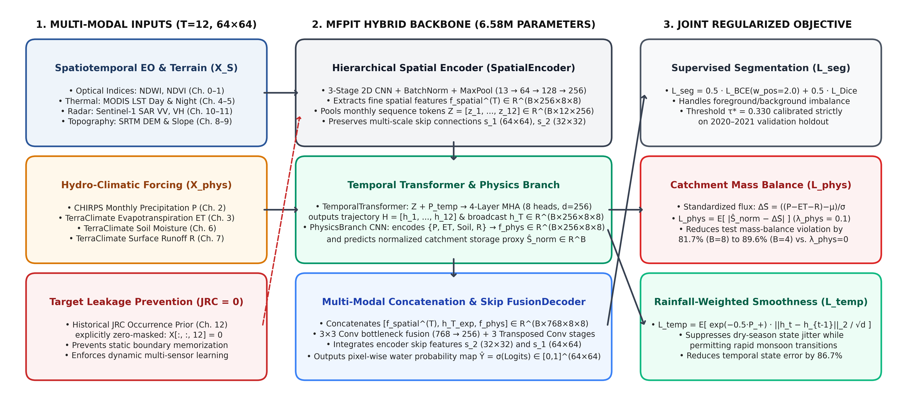
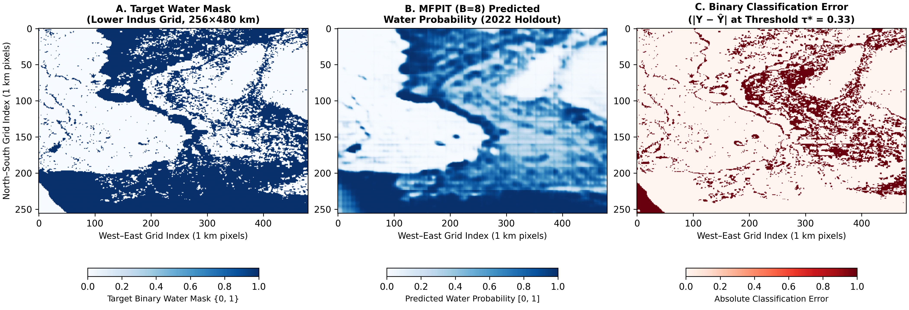
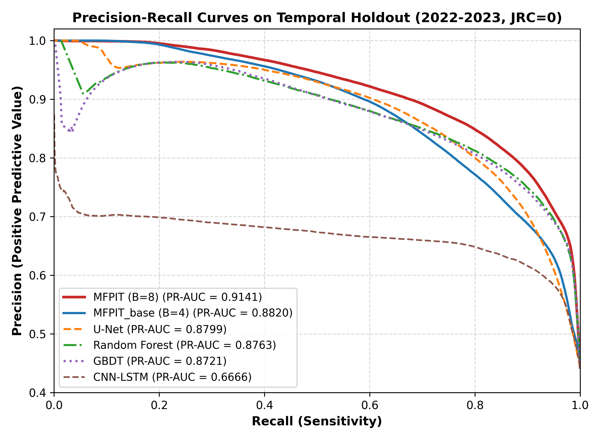
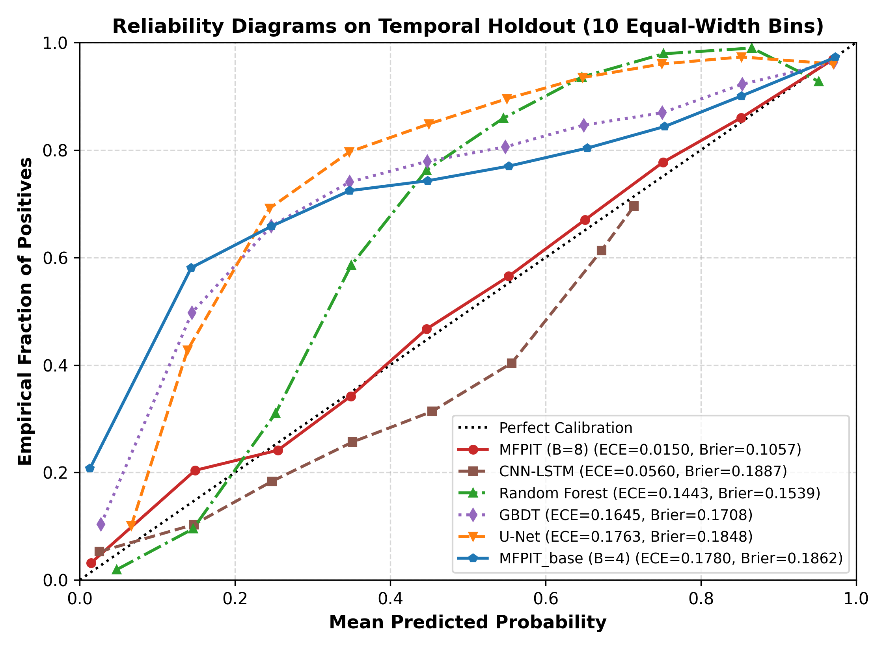

# MFPIT: Multimodal Flood Physics-Regularized Transformer

[](LICENSE)
[](requirements.txt)
[](requirements.txt)

This repository contains the official PyTorch implementation of **MFPIT** (Multimodal Flood Physics-Regularized Transformer), a scientific machine learning (SciML) framework designed for spatiotemporal water occurrence mapping and flood susceptibility prediction in data-scarce coastal deltaic basins (benchmarked on the Lower Indus River Basin and Delta, Sindh, Pakistan).

---

## 📖 Overview

MFPIT addresses two fundamental limitations of traditional machine learning models in remote sensing and ecohydrology:
1. **Multi-Fidelity Resolution Mismatch**: Scale disparities between optical/radar satellite observations and coarse-resolution regional hydro-climatological forcing variables ($P, ET, \text{Soil}, R$ from CHIRPS and TerraClimate).
2. **Physical & Temporal Inconsistency**: Purely data-driven neural networks often violate macroscopic water-budget constraints and exhibit spurious dry-season oscillations. MFPIT embeds a **standardized catchment mass-balance regularization** constraint ($\mathcal{L}_{\text{phys}}, \lambda_{\text{phys}}=0.1$) alongside a **bounded inverse-rainfall weighted temporal consistency penalty** ($\mathcal{L}_{\text{temp}}, \lambda_{\text{temp}}=0.1$).

### Target Leakage Prevention (`JRC=0`)
To prevent target data leakage from historical water occurrence composites, this implementation enforces a strict **Matched-Evaluation (`JRC=0`)** protocol. Channel 12 (JRC historical water occurrence prior) is explicitly zeroed out ($\mathbf{X}_{:, :, 12, :, :} = 0$) during all training, validation, and testing runs, forcing models to rely strictly on dynamic spectral, radar, hydroclimate, and topographic observations.

---

## 🏗️ System Architecture



The **MFPIT** architecture ($6.58\text{M}$ trainable parameters; $6,577,318$ exact parameters) processes $12$-month multi-sensor spatial sequences ($\mathbf{X} \in \mathbb{R}^{B \times 12 \times 13 \times 64 \times 64}$, exported on a unified $1\text{ km}$ basin-scale grid of $279 \times 502$ pixels across the Lower Indus Basin and Delta) through four coupled modules:
1. **Hierarchical Spatial Encoder (`SpatialEncoder`)**: Extracts multi-scale spatial feature maps and pooled monthly tokens across 3 convolutional stages ($64 \to 128 \to 256$ channels).
2. **Multi-Head Temporal Transformer (`TemporalTransformer`)**: Models 12-month phenological and monsoonal trajectories across $L=4$ Transformer encoder layers ($8$ heads, $d_{\text{model}}=256$, learnable temporal positional encoding) and outputs the hidden-state trajectory $\mathbf{H} = [\mathbf{h}_1, \dots, \mathbf{h}_{12}]$ for rainfall-weighted temporal consistency regularization ($\mathcal{L}_{\text{temp}}, \lambda_{\text{temp}}=0.1$).
3. **Hydro-Climatic Physics Branch (`PhysicsBranch`)**: Encodes CHIRPS precipitation ($P$), TerraClimate evapotranspiration ($ET$), soil moisture ($\text{Soil}$), and surface runoff ($R$) into a $256$-channel physical context representation and predicts a standardized catchment storage proxy $\hat{S}_{\text{norm}}$ regularized against $\widetilde{\Delta S} = (P - ET - R - \mu)/\sigma$ ($\mathcal{L}_{\text{phys}}, \lambda_{\text{phys}}=0.1$).
4. **Multi-Modal Fusion & U-Net Skip Decoder (`FusionDecoder`)**: Concatenates spatial, temporal, and physical bottlenecks ($768 \to 256$ channels) and decodes $64 \times 64$ flood segmentation probabilities via skip connections.

---

## 📁 Repository Structure

```text
MFPIT_Project/
├── LICENSE                         # MIT License
├── README.md                       # Documentation & verified benchmark summary
├── requirements.txt                # Python dependencies
├── paper(finalRevised).tex         # Verified LaTeX manuscript source (elsarticle)
├── paper(finalRevised).pdf         # Compiled manuscript PDF
├── references.bib                  # Verified BibTeX bibliography (37 verified entries)
├── MFPIT_step1_create_dirs.py      # Script to initialize directory tree
├── data/                           # Dataset directories
│   ├── DOWNLOAD_MANIFEST.csv       # GEE download manifest
│   └── processed/                  # Standardized z-score stats (data_stats.json)
├── figures/                        # Verified publication-quality plots and figures
├── gee/                            # Google Earth Engine data extraction scripts
│   ├── gee_auth_check.py           # Authentication check utility
│   └── gee_data_extractor.py       # Bulk image and time-series downloader (1 km grid)
└── models/                         # PyTorch implementation, ablations, and baselines
    ├── MFPIT_Model.py              # Primary model architecture (6.58M params)
    ├── dataset.py                  # Spatiotemporal 64x64 patch dataset loader
    ├── losses.py                   # Combined BCE, Dice, Physics, and Temporal losses
    ├── metrics.py                  # IoU, F1, PR-AUC, ROC-AUC, Brier, and ECE metrics
    ├── train.py                    # Baseline training script (B=4)
    ├── run_ablations.py            # Full B=8 training & retrained modality ablations
    ├── train_lambda_0.py           # Unconstrained (lambda_phys=0.0) ablation training
    ├── evaluate_all.py             # Validation threshold sweep & test evaluation
    ├── evaluate_test_time_ablations.py # Zero-shot channel masking sensitivity
    ├── run_weight_sensitivity.py   # Monte Carlo Gaussian weight perturbation study
    ├── eval_dynamic_2022_target.py # Disaggregated 2020-2023 & dynamic 2022 flood mask evaluation
    ├── bootstrap_ci.py             # 1,000-replicate spatial block-bootstrap CIs
    └── baselines/                  # Baselines (U-Net, CNN-LSTM, GBDT, Random Forest)
```

---

## 🛠️ Installation & Setup

### 1. Clone the Repository
```bash
git clone https://github.com/mirzamuzzamilbaig/MFPIT.git
cd MFPIT
```

### 2. Initialize the Project Structure
```bash
python MFPIT_step1_create_dirs.py
```

### 3. Install Dependencies
```bash
pip install -r requirements.txt
```

---

## 🛰️ Data Acquisition & Preprocessing

The dataset spans **23 annual volumes (2001–2023)**, corresponding to **276 monthly observations** over the Lower Indus Basin and Delta bounding box (`67.0–69.5°E`, `23.5–28.0°N`, exported on a unified `279 × 502` grid at `1,000 m` resolution). Tiling into `64 × 64` patches with stride `32` yields `98` 12-month sequence patches per year:
- **Training Split (2001–2019, 19 years)**: `1,862` 12-month sequences (`22,344` monthly patch slices)
- **Validation Split (2020–2021, 2 years)**: `196` 12-month sequences (`2,352` monthly patch slices; `802,816` evaluated pixels)
- **Test Split (2022–2023, 2 years)**: `196` 12-month sequences (`2,352` monthly patch slices; `802,816` evaluated pixels)

```bash
# 1. Verify Google Earth Engine authentication
python gee/gee_auth_check.py

# 2. Extract static terrain (DEM, Slope) and dynamic multi-sensor rasters (2001-2023)
python gee/gee_data_extractor.py --dataset static
python gee/gee_data_extractor.py --dataset all --years 2001 2023

# 3. Compile annual PyTorch tensors and training-split normalization stats
python models/preprocess.py
```

---

## 📊 Verified Benchmark Results (`JRC=0` Temporal Holdout, 2022–2023)

Across the strictly leak-free **JRC=0** temporal holdout ($n = 196$ 12-month sequence patches; $802,816$ evaluated pixels), with decision thresholds $\tau^*$ calibrated strictly on the 2020–2021 validation split:

| Model Architecture | Params | Opt. Thresh ($\tau^*$) | Test IoU [95% Bootstrap CI] | Test F1 [95% Bootstrap CI] | PR-AUC [95% Bootstrap CI] | ROC-AUC | Brier $\downarrow$ | ECE $\downarrow$ | Patch Fraction $R^2 \uparrow$ |
| :--- | :---: | :---: | :---: | :---: | :---: | :---: | :---: | :---: | :---: |
| **Random Forest** | 100 trees | 0.250 | 0.6839 [0.6492, 0.7082] | 0.8122 [0.7873, 0.8292] | 0.8763 [0.8494, 0.8899] | 0.9115 | 0.1539 | 0.1443 | 0.5701 |
| **GBDT** | 100 trees | 0.110 | 0.6872 [0.6584, 0.7119] | 0.8146 [0.7941, 0.8317] | 0.8721 [0.8462, 0.8880] | 0.9102 | 0.1708 | 0.1645 | 0.4166 |
| **2D U-Net** | 7.80M | 0.100 | 0.6489 [0.5929, 0.6609] | 0.7871 [0.7444, 0.7959] | 0.8799 [0.8479, 0.8904] | 0.8968 | 0.1848 | 0.1763 | 0.2637 |
| **CNN-LSTM** | 5.81M | 0.490 | 0.5764 [0.5350, 0.6106] | 0.7313 [0.6971, 0.7582] | 0.6666 [0.6146, 0.7017] | 0.7772 | 0.1887 | 0.0560 | 0.6354 |
| **MFPIT_base ($B=4$)** | 6.58M | 0.030 | 0.6484 [0.6097, 0.6715] | 0.7867 [0.7576, 0.8035] | 0.8820 [0.8559, 0.8940] | 0.8942 | 0.1862 | 0.1780 | 0.7495 |
| **MFPIT ($B=8$, Ours)** | **6.58M** | **0.330** | **0.7102 [0.6787, 0.7370]** | **0.8306 [0.8086, 0.8486]** | **0.9141 [0.8928, 0.9273]** | **0.9296** | **0.1057** | **0.0150** | **0.9564** |

- **Physical & Temporal Consistency**: Joint regularization ($\lambda_{\text{phys}}=0.1, \lambda_{\text{temp}}=0.1$) reduces test-set standardized catchment mass-balance residuals ($\mathcal{L}_{\text{phys}}$) by **81.7%–89.6%** (from `1.3085` unconstrained to `0.2391` for $B=8$ and `0.1355` for $B=4$) and temporal hidden-state jitter ($\mathcal{L}_{\text{temp}}$) by **86.7%** (from `0.0173` to `0.0023`).
- **2022 Pakistan Mega-Flood Resilience (`test_2022.pt`, $+2.20\sigma$ Runoff Shock)**: Unconstrained training ($\lambda_{\text{phys}}=0.0$) collapses to **IoU `= 0.4967`** and **$R^2 = 0.2959$**, whereas physics-regularized **MFPIT ($B=8$)** maintains **IoU `= 0.6962` (`+19.95%` gain)** and **$R^2 = 0.9382$** ($\text{MAE} = 0.0555$).
- **Dynamic 2022–2023 Monsoon Inundation Mask (`Y_dyn`)**: Evaluated against dynamic monsoon flood expansion ($\Delta\text{NDWI}_{\text{Aug–Sep}} > 0.5\sigma$), static terrain models degrade sharply while **MFPIT ($B=8$) ranks #1 across all models (IoU `= 0.6456`, F1 `= 0.7847`, PR-AUC `= 0.8259`, ROC-AUC `= 0.8507`)**.

### Spatial Boundaries (Lower Indus Basin Test Holdout)


### Precision-Recall & Calibration Reliability



---

## 🛡️ License

This project is licensed under the MIT License - see the [LICENSE](LICENSE) file for details.

---

## ✍️ Citation

If you find this codebase or research useful, please cite our paper:

```bibtex
@article{muzzamil2026integrating,
  title={Integrating Multimodal Earth Observations and Hydrological Regularization for Spatiotemporal Wetland Water Mapping in the Indus Delta},
  author={Muzzamil, Mirza Muhammad},
  journal={Ecological Informatics},
  note={Under Review},
  year={2026}
}
```
